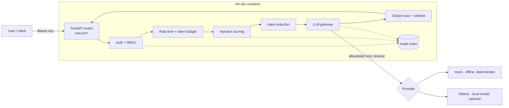

# Architecture

## Run modes

| Mode | What is mounted | Intended use |
|---|---|---|
| `secure` (default) | `/secure/*` baseline API, `/health`, `/owasp/categories` | Local development, demos, anything that is not an isolated training target |
| `lab` | The above plus the intentionally vulnerable `/llm01` to `/llm10` and `/legacy` scenarios | The `llm01` VM and the compose `lab` profile only |

Mode comes from `LLM_LAB_MODE`. Anything other than `lab` is treated as `secure`.
The `llm01` systemd unit sets `lab` explicitly, so the VM behaves as before.

## Components

## Data flow for `POST /secure/chat`

1. Authenticate the bearer key (constant-time compare), then authorize the `chat:use` permission. Failures are audited.
2. Apply the per-user rate limit and check the daily token budget before any work happens.
3. Score the prompt for injection. At or above the threshold the request is blocked and audited.
4. Redact PII and credential-like values from the prompt.
5. Call the gateway with a fixed system message and the user text as a separate message. The gateway enforces a timeout and output cap.
6. Scan and sanitize the model output (redaction, control characters removed). The response is a typed schema marked `text/plain`.
7. Record usage and write an audit event holding a length and short hash of the prompt, never the prompt itself.

## Trust boundaries

| Boundary | Crossing | Control |
|---|---|---|
| Client to API | Untrusted input, credentials | TLS at the proxy in front, bearer auth, strict schema, size limits |
| API to gateway | Authorized, scanned request | Injection scoring, redaction, budget |
| Gateway to provider | Outbound call | Host allowlist, timeout, no provider credentials in prompts |
| Model output to client | Untrusted output | Scan, sanitize, plain text only, never rendered or executed |
| Container to host | Process isolation | Non-root user, read-only root, all capabilities dropped, no-new-privileges |
| Lab mode to everything else | Vulnerable code | Only mounted on request; compose `lab` profile binds to 127.0.0.1 |

Privilege boundary: the `viewer` role can chat and read its own usage. Only `admin` can read the audit log and runtime config.

## Stack and open-source alternatives

| Concern | Used now | Alternatives for later phases |
|---|---|---|
| API | FastAPI, Pydantic | Litestar, Django Ninja |
| Model serving | Mock provider, Ollama | vLLM, llama.cpp server, LiteLLM as a gateway |
| Vector store (planned) | Not yet | pgvector, Qdrant, Chroma |
| Observability (planned) | JSON logs and audit chain | OpenTelemetry SDK, Collector, Prometheus, Grafana, Loki, Tempo |
| Secrets | Environment variables from `.env` | Docker/Kubernetes secrets, SOPS, Vault |
| Policy (planned) | In-code RBAC | Open Policy Agent |

## Deployment options

| Option | Status | How |
|---|---|---|
| Local process | Available | `LLM_LAB_API_KEYS=... uvicorn app.main:app` from `llm-lab/` |
| Docker Compose | Available | `docker compose up -d --build` (see the README) |
| `llm01` VM | Available, unchanged | `LAB_PROFILE=llm vagrant up llm01` |
| Kubernetes | Planned (phase 5) | Manifests with NetworkPolicy, PodSecurity `restricted`, secrets |
